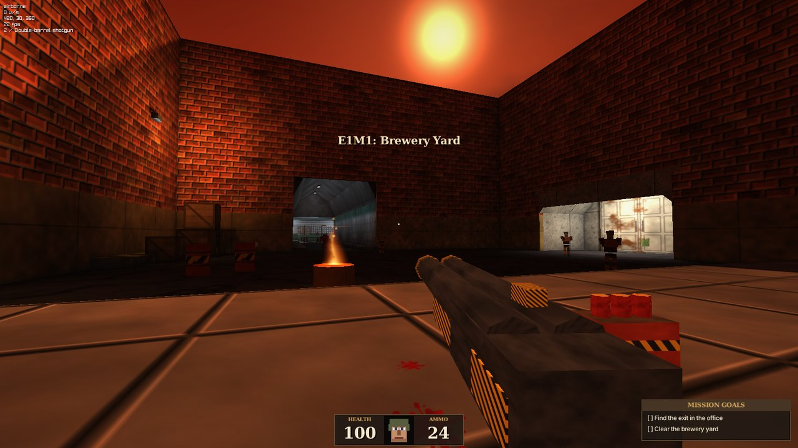
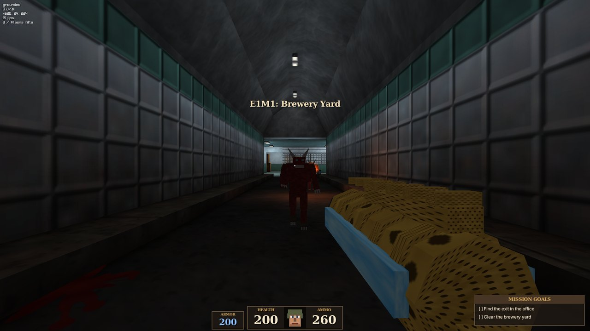
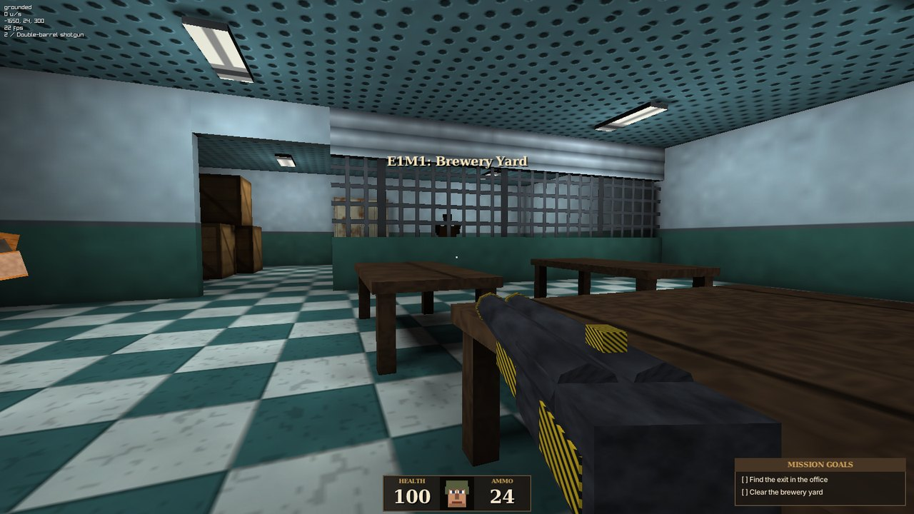
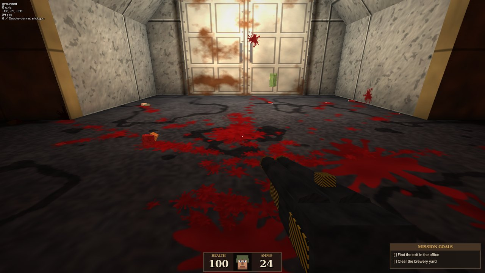
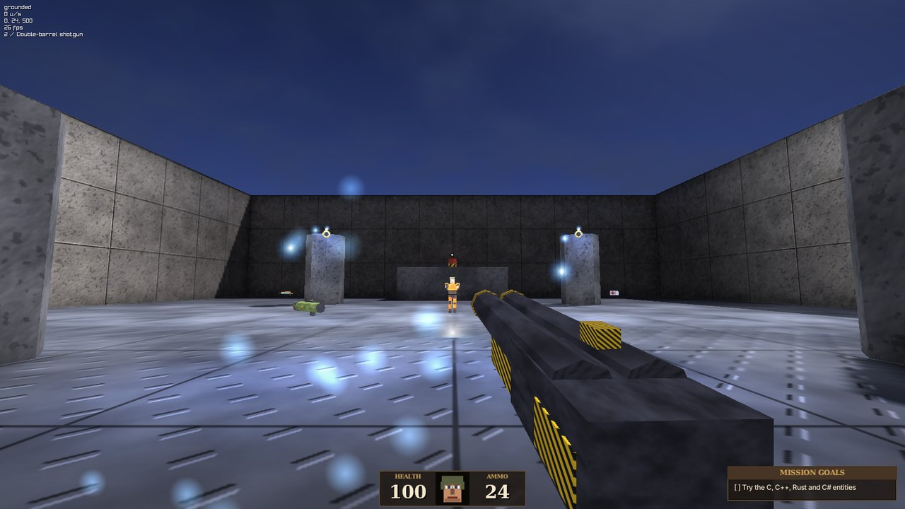
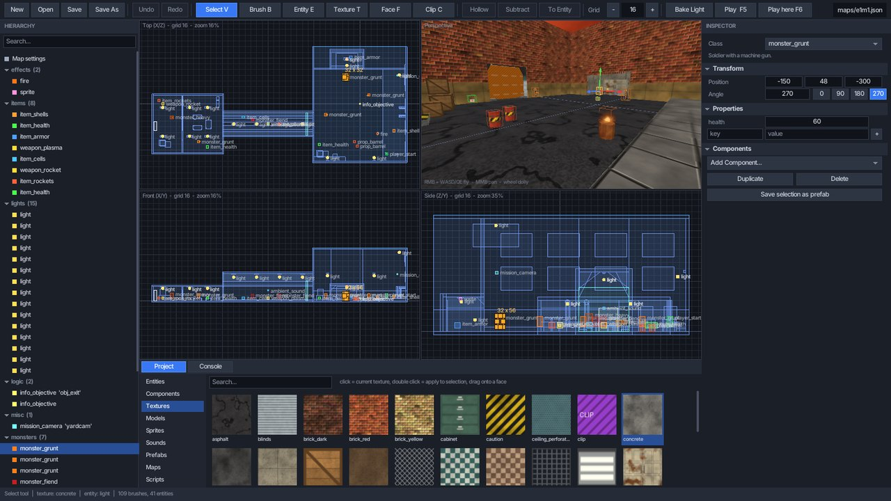
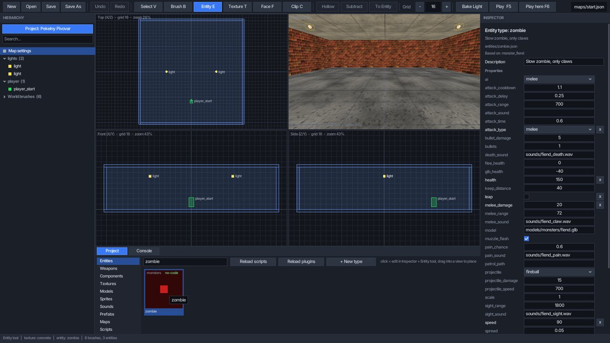
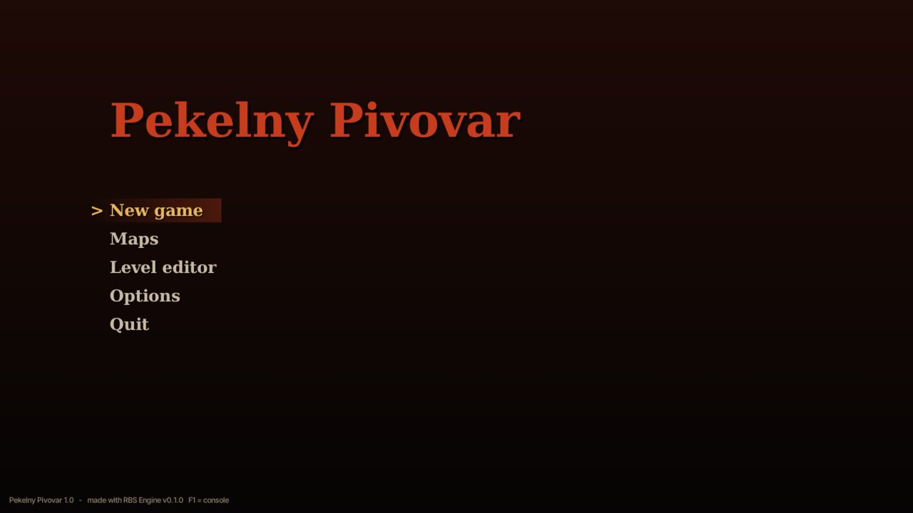

# RBS Engine — retro boomer shooter engine

Open-source **engine a nástroj na tvorbu vlastních retro FPS** ve stylu Quake / Doom 90. let – něco jako Unity nebo FPS Creator, ale zaměřené na boomer shootery. Je to **desktopová aplikace** (žádný web) s plně 3D modely, předpočítaným osvětlením, gore efekty a editorem ve stylu Unity.

Každý si v něm může udělat **vlastní hru**: levely, nepřátele, zbraně, předměty, menu i nastavení – **bez programování**, přímo v editoru. Kdo chce víc, napíše si vlastní AI, zbraně nebo pravidla v **Lua** (bez kompilace), nebo v **C, C++, Rustu, C#** (a čemkoli dalším, co umí C ABI). Hotovou hru jedním tlačítkem vyexportuješ jako **samostatnou aplikaci** pro hráče. Součástí je ukázková hra, ze které můžeš vycházet.



| | |
|---|---|
|  |  |
|  |  |



| Nepřítel bez kódu: AI z rozbalovacích seznamů | Menu vlastní vyexportované hry |
|---|---|
|  |  |

## Co umí

**Tvorba her**
- **Projekty**: každá hra je složka v `mods/` s vlastními levely, obsahem, menu (nadpis, pozadí) a nastavením hráče. Nový projekt jedním kliknutím v editoru.
- **Nepřátelé bez kódu**: vestavěná AI s režimy *chase / ranged / melee / turret / patrol*, útoky hitscan / projektil / zblízka / skok, hlídky po waypointech, přepadení, útěk při zranění – vše nastavitelné v Inspectoru s rozbalovacími seznamy a nápovědou.
- **Zbraně a předměty bez kódu**: nová zbraň je kopie existující s jinými hodnotami (poškození, rozptyl, kadence, munice, projektil, model, zvuk); každá zbraň má hned i sebratelnou verzi do mapy.
- **Logika levelů bez kódu**: dveře, tlačítka, výtahy, klíče, triggery, tajné místnosti, cíle mise, kamery, přechody mezi levely.
- **Vlastní kód, když je potřeba**: přepiš jen útok, rozhodování nebo celé chování nepřítele; Lua i nativní pluginy.
- **Build game**: export samostatné hry (spustitelný soubor s názvem hry + data + licence), která se spustí rovnou do tvého menu.

**Engine**
- Nativní aplikace pro **Windows, Linux a macOS** (C++17 + [raylib](https://www.raylib.com), OpenGL 3.3).
- Mapy z konvexních **brushů** (jako Quake) – CSG odečítání, dutí, řezání, šikmé plochy, dveře/výtahy jako brush entity.
- **Lightmapy se stíny** pečené na všech jádrech CPU: bodová světla, reflektory, slunce, světlo z oblohy, **odražené světlo** (1 bounce) a ambient occlusion. Výsledek se cachuje.
- **Dynamická světla** (záblesky výstřelů, plazma, oheň, blikající světla), **procedurální obloha** s mraky a sluncem, mlha.
- **3D modely glTF** (.glb/.gltf) se skeletální animací, plus OBJ/IQM/M3D. Textury PNG/TGA/JPG.
- Pohyb jako v Quake: **strafe-jumping, bunny hopping**, schody, svahy, jízda na výtazích.
- **Gore**: krev jako částice i **decaly ořezané podle geometrie** a nasvícené lightmapou, gibs, rozstřelitelné mrtvoly.
- Hitscan i projektilové zbraně, exploze s radiusovým poškozením (i rocket jump), AI nepřátel.
- HUD, cíle mise, obraz kamery v rohu (mission camera), statistiky na konci levelu, menu, nastavení, **konzole** s proměnnými.
- Retro post-process: nižší rozlišení s ostrými pixely, paletová posterizace s ditheringem, vinětace.

**Modding a skriptování**
- Virtuální souborový systém: **mod = složka v `mods/`**, která může přepsat nebo přidat libovolný soubor (textury, modely, zvuky, mapy, skripty, shadery, fonty, překlady).
- Lua běží v **sandboxu** (žádný přístup k disku ani systému), takže cizí mody jsou bezpečné. Nativní pluginy mají plná práva – pouštěj jen ty, kterým věříš.
- Menu, HUD i hlášky ve hře jsou **česky i anglicky** (`lang/cs.json`), mody můžou přidávat vlastní překlady.
- **Lua**: třídy entit, **komponenty** (jako v Unity), zbraně, AI, HUD, pravidla hry, skripty map – vše bez kompilace.
- **Nativní pluginy přes C ABI**: piš entity a komponenty v **C, C++, Rustu, C# (NativeAOT)**, Zigu, Go… Hotové příklady ve všech čtyřech jazycích.
- Komponenty z různých jazyků jde kombinovat na jedné entitě.

**Editor (ve stylu Unity)**
- **Hierarchy**, **Inspector** (transform, vlastnosti, komponenty + *Add Component*), **Project** prohlížeč assetů s **drag & drop**, **Console**.
- Pohledy Top / Front / Side + 3D perspektiva s gizmem, mřížka, přichytávání.
- Nástroje: výběr, kreslení brushů, entity, malování textur, úprava textur ploch (posun/měřítko/rotace/fit), řezání (clip), **CSG Subtract**, **Hollow**, prefaby, kopírovat/vložit, undo/redo.
- **Bake Light** s náhledem v editoru, **Play** (F5) a **Play from here** (F6) přímo z editoru.
- **Import přetažením**: soubory a složky z průzkumníku pusť do okna editoru – textury, modely, zvuky, fonty i skripty se zkopírují do modu a jdou rovnou použít.

## Rychlý start

### Sestavení

Potřebuješ **CMake ≥ 3.20** a C++17 kompilátor. Závislosti (raylib, Lua, nlohmann/json) se stáhnou automaticky.

**Linux** (Debian/Ubuntu):
```bash
sudo apt install build-essential cmake git libx11-dev libxrandr-dev libxinerama-dev libxcursor-dev libxi-dev libgl1-mesa-dev libasound2-dev
```
```bash
cmake -S . -B build -DCMAKE_BUILD_TYPE=Release
```
```bash
cmake --build build -j
```
```bash
./build/rbs
```

**Windows** (Visual Studio 2022 nebo Build Tools):
```bash
cmake -S . -B build
```
```bash
cmake --build build --config Release
```
```bash
build\Release\rbs.exe
```

**macOS** (Xcode Command Line Tools):
```bash
cmake -S . -B build -DCMAKE_BUILD_TYPE=Release && cmake --build build -j && ./build/rbs
```

Spustitelný soubor si najde složku `base/` sám (vedle sebe nebo v nadřazených složkách), takže jde spouštět přímo z `build/`. Hotový balíček pro hráče (spustitelný soubor + data + dokumentace) vytvoříš příkazem `cmake --install build --component game --prefix dist`.

### Spuštění

```bash
./build/rbs                         # hlavní menu
./build/rbs --map e1m1              # rovnou mapa
./build/rbs --editor e1m1           # editor
./build/rbs --mod example_mod       # s modem
```

### Vlastní hra

```bash
./build/rbs --editor
```
V editoru klikni nahoře v panelu Hierarchy na **Project** → **New project...**, pojmenuj hru a začni stavět. Celý postup – levely, nepřátelé, zbraně, nastavení a export – je v návodu **[Jak udělat vlastní hru](docs/GAME_CREATION.md)**.

## Ovládání

| Hra | |
|---|---|
| WASD | pohyb (Shift = chůze) |
| Myš | rozhlížení |
| Mezerník | skok (držením bunny hop) |
| LMB | střelba |
| 1–9, kolečko | zbraně |
| E | použít (dveře, tlačítka) |
| Tab | cíle mise |
| Esc | pauza / zpět do editoru |
| ` nebo F1 | konzole |

Klávesy jdou přemapovat v konzoli (`bind_forward W`, `bind_fire MOUSE1`…) a ukládají se do `config.cfg`.
Editor: viz [docs/EDITOR.md](docs/EDITOR.md).

## Struktura projektu

```
src/            zdrojový kód enginu (C++)
  core/         VFS (mody), konzole a proměnné, vstup
  world/        brushe, CSG, mapy (JSON), kolize (BVH)
  render/       renderer, lightmapper, assety
  game/         hra: entity, fyzika, hráč, boj, efekty
  script/       Lua API a nativní pluginy
  editor/       editor map
  ui/           UI toolkit, konzole, fonty, překlady
base/           data hry (vše se dá přepsat modem)
  maps/ scripts/ textures/ models/ sounds/ sprites/ decals/ hud/ shaders/ fonts/ lang/
mods/           projekty her a mody (example_mod = Lua, plugin_demo = nativní pluginy)
builds/         exportované hry (Build game, není v gitu)
sdk/            C API pro nativní pluginy + příklady (C, C++, Rust, C#)
tools/          generátory assetů a ukázkových map (Python)
docs/           dokumentace
```

## Dokumentace

- **[Jak udělat vlastní hru](docs/GAME_CREATION.md)** – projekt, levely, nepřátelé, zbraně a předměty bez kódu, menu, export
- [AI nepřátel](docs/AI.md) – vestavěná AI a všechny její vlastnosti, vlastní AI v Lua a v pluginech
- [Modování](docs/MODDING.md) – mody, `mod.json`, formáty assetů, modely z Blenderu, textury, zvuky
- [Questy a dialogy](docs/QUESTS.md) – příběh jako graf: objektivy, větvení, rozhovory, proměnné mezi mapami
- [Behavior trees](docs/BEHAVIOR.md) – AI jako graf: uzly, blackboard, vnímání, vlastní uzly
- [Animátory](docs/ANIMATION.md) – stavové automaty animací: přechody, prolínání, události
- [Lua skriptování](docs/SCRIPTING.md) – kompletní API: třídy, komponenty, zbraně, AI, HUD, hooky
- [Nativní pluginy](docs/PLUGINS.md) – C / C++ / Rust / C# / Zig / Go přes C ABI
- [Editor](docs/EDITOR.md) – nástroje, klávesy, postupy
- [Formát mapy](docs/MAP_FORMAT.md)
- [Architektura enginu](docs/ARCHITECTURE.md) – pro přispěvatele

## Konzole

`help` vypíše příkazy, `cvarlist` proměnné. Užitečné: `map e1m1`, `editor`, `god`, `noclip`, `give all`, `weapon plasma`, `mod example_mod`, `project`, `new_project <složka> [název]`, `build_game`, `lang cs`, `r_scale 0.5` (chunky pixely), `r_posterize 24` (retro paleta), `fov 110`, `lua <kód>`, `import <soubor/složka>`, `reload_plugins`, `screenshot`.

## Testy

`tools/smoke_test.sh` spustí bez okna (přes Xvfb) demo mapu, editor a oba ukázkové mody, vytvoří nový projekt, vyexportuje ho jako samostatnou hru a tu spustí. Uloží screenshoty a selže při chybě ve skriptech, chybějícím assetu nebo nenačteném pluginu. Totéž běží v GitHub Actions (`.github/workflows/build.yml`) spolu s buildem pro Linux, Windows a macOS.

## Assety

Všechny výchozí textury, modely, zvuky a mapy jsou vygenerované skripty v `tools/` (Python + numpy + Pillow), takže je jde kdykoli znovu vytvořit nebo upravit:

```bash
python3 tools/gen_textures.py && python3 tools/gen_models.py && python3 tools/gen_sounds.py && python3 tools/gen_demo_map.py
```

Jsou to zástupné assety – nahraď je vlastní grafikou (PNG, glTF z Blenderu, WAV/OGG) se stejnými názvy, nebo přidej nové v modu.

## Licence

MIT – viz [LICENSE](LICENSE). Licence knihoven a fontů v [THIRD_PARTY.md](THIRD_PARTY.md).

---

## English summary

**RBS Engine** is an open-source engine and creation tool for retro boomer shooters (think Unity or FPS Creator, focused on Quake/Doom-style games), written in C++17 on top of raylib. It is a native desktop application (Windows / Linux / macOS) featuring Quake-style brush maps with CSG, ray-traced lightmaps with bounce light and AO, glTF skeletal models, Quake movement (strafe jumping, bunny hopping), gore decals and gibs, and a Unity-style editor (Hierarchy, Inspector with components, Project browser with drag & drop, 4 viewports, gizmo, prefabs, bake & play in editor). Anyone can make their own game in it: a game is a project folder with its own levels, menu and settings; enemies (built-in AI with chase/ranged/melee/turret/patrol modes, attack types, patrols, ambushes), weapons and items are made **without code** in the editor, and **Build game** exports a standalone game. For anything else, gameplay is scripted in **Lua**, and entity classes/components can also be written as **native plugins in C, C++, Rust or C#** (or any language with a C ABI). Build with CMake (`cmake -S . -B build && cmake --build build`), run `build/rbs`. See `docs/` (Czech) for the game creation guide, AI, scripting API, plugin SDK, editor manual and map format.
